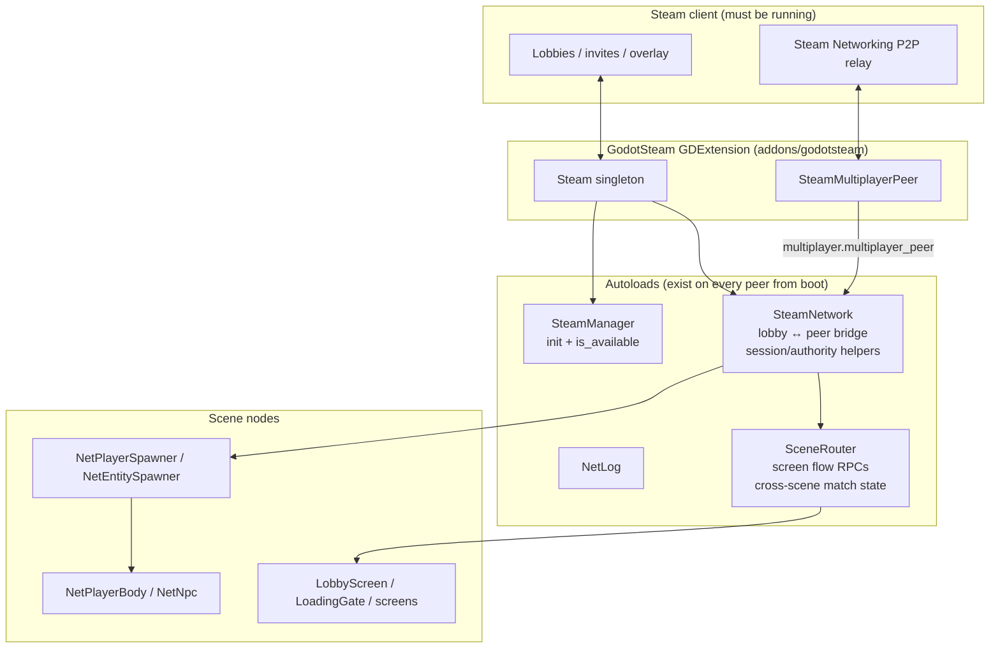
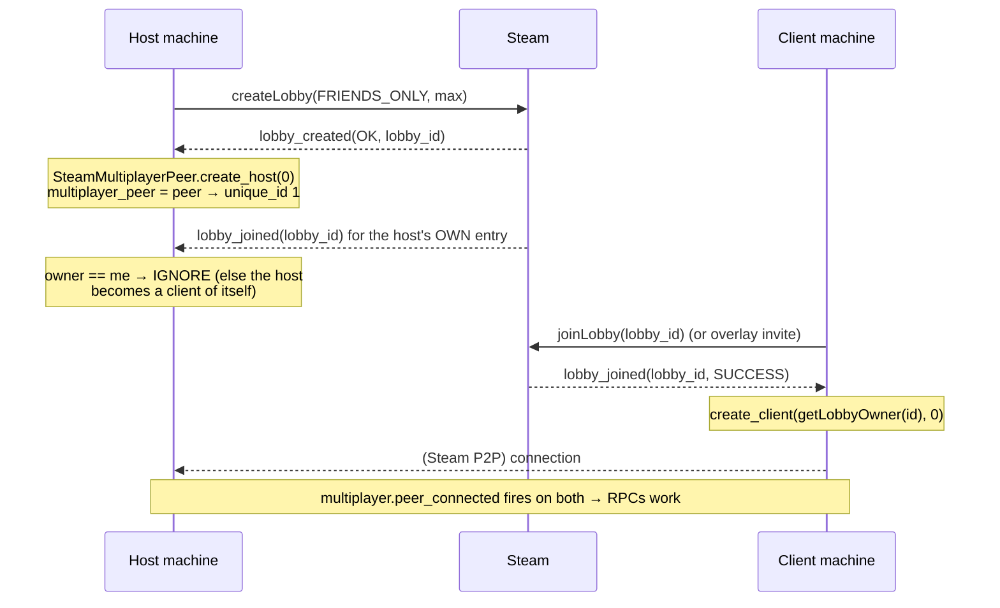
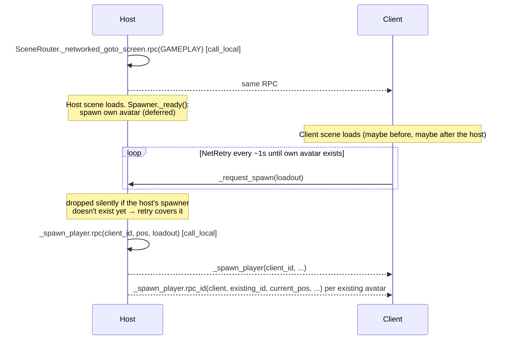
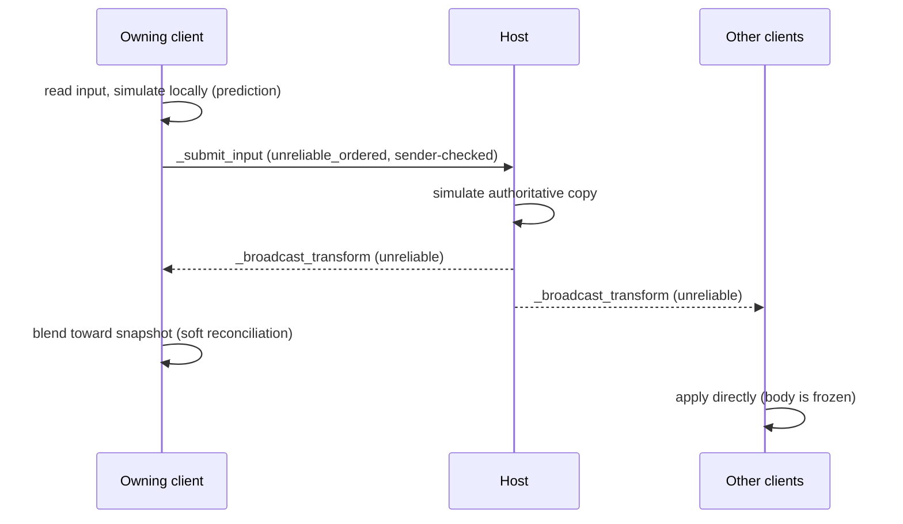

# 01 — Architecture

How the Steam multiplayer stack is put together and why. Read this before changing anything
networked.

---

## 1. The model in one paragraph

A **host-authoritative listen server** on **Steam peer-to-peer** networking. One player hosts, and
their machine runs the only real simulation of everything shared: physics, AI, scoring, round
flow. Clients send **input and requests**. The host **validates**, **simulates**, and
**broadcasts results**. Steam lobbies handle discovery and invites. GodotSteam's
`SteamMultiplayerPeer` plugs Steam's transport into Godot's own `MultiplayerAPI`, so gameplay code
uses ordinary `@rpc` functions and knows nothing about Steam. **Solo play is a session of one**:
the same code paths run with no lobby, and the local machine is the authority.

## 2. Why this model (and not the alternatives)

| Alternative | Rejected because |
|---|---|
| Deterministic lockstep / rollback | Physics engines (Jolt included) are **not bit-identical across machines**. Re-simulating the same inputs won't converge, so there's nothing to roll back to. |
| Client-authoritative (each client owns its own state) | Competitive game: a modified client could claim any catch, hit, or score. The host must decide. |
| Client-plays, host-validates-afterward | Interference mechanics (one player affecting another's entity) need one machine that owns the truth *while it happens*, not after. |
| Dedicated server | Friends-only, small lobbies; a listen server costs nothing to run. |
| `MultiplayerSynchronizer` / `SceneReplicationConfig` | Deliberately deferred, not rejected. Plain RPC broadcasts were easier to get right and debug. Swapping in synchronizers later is fine, since authority rules don't change. |
| `netfox` rollback addon | Assumes re-simulatable physics, which is ruled out above. Hand-rolled soft reconciliation instead (see [04_PATTERNS.md](04_PATTERNS.md) P10). |

**Accepted cost:** clients see other players' state about one round trip late. The owning client's
*own* avatar is predicted locally so their controls feel instant (P10). Everything else is
display-only on clients.

## 3. Layers



**Autoload order matters** (project.godot `[autoload]`):

1. `NetLog`: everything logs through it.
2. `SteamManager`: owns `Steam.steamInitEx()`.
3. `SteamNetwork`: connects Steam signals in `_ready()` (connecting doesn't need init).
4. `SceneRouter`: uses `SteamNetwork` helpers.
5. Your own game-state autoloads.

The boot scene calls `SteamManager.initialize()` **once, before the first screen loads**.
Nothing self-initializes in `_ready()`.

## 4. Identity: five different "who" values

Most networking bugs come from mixing these up.

| Concept | Type | Where it comes from | Same on every peer? | Use it for |
|---|---|---|---|---|
| **Steam ID** | 64-bit int | `Steam.getSteamID()`, lobby member lists | Yes | Display names, lobby membership, `create_client(host_steam_id)`. **Never** for RPC targeting. |
| **Godot peer id** | int | `multiplayer.get_unique_id()` | Each peer's own id is known to all | RPC targeting (`rpc_id`), `get_remote_sender_id()`, rosters. **Host is always `1`.** Solo is also `1`. |
| **`owner_peer_id`** | int (game field) | Set by the spawner before `add_child()` | Yes | "Whose **input** drives this avatar?" |
| **Multiplayer authority** | int (Godot) | `set_multiplayer_authority()`, default `1` | Yes | "Who may **write** this node's state / call its `"authority"` RPCs?" **Leave it at 1 (host) for everything.** |
| **`entity_id`** | int (game field) | Host counter at spawn | Yes | Referring to a non-player entity across the wire ("fish 17 bit hook 3"). |

Plus **node names**. RPCs are delivered to a **NodePath**, so a networked node must have the
**same name and parent path on every peer**. Name it deterministically (`Player_<peer_id>`,
`Entity_<entity_id>`, `Hook_<owner>_<sequence>`) **before** `add_child()`.

> **Input ownership ≠ authority.** A client's avatar has `owner_peer_id = <client>` but authority
> `1`. The client reads its keyboard and relays it; the host writes the state. Changing an
> avatar's authority to its owner turns the design into client-authoritative. Don't.

## 5. Who decides what (authority matrix)

| Thing | Decided by | Clients do |
|---|---|---|
| Lobby creation, membership | Steam | Join via id or overlay invite |
| Screen transitions, round counter, match reset | Host (`SceneRouter`) | Follow `call_local` broadcasts |
| Spawning players | Host, **on client request** | Request once their scene exists, then retry |
| Spawning entities / NPCs | Host only | Receive live broadcasts + catch-up |
| Spawn positions, random rolls (size, loot) | Host, rolled once, sent as data | Never re-roll |
| Avatar movement | Host simulates. Owner predicts its own | Owner relays input; others display |
| NPC AI | Host only (`is_multiplayer_authority()`) | Interpolate positions, mirror state |
| Discrete actions (attack, cast, use, pick) | Host validates, then broadcasts | Send request; wait for broadcast |
| Scores, results, ready-counts | Host | Display |
| Level layout from randomness | **Every peer independently**, from a shared seed (lobby id) | Same as host. No RPC needed. |
| Per-machine choices (cosmetics, loadout) | The owning machine | Send as data with the spawn request |
| Purely cosmetic reactions (SFX, VFX) | Each peer locally | React to replicated state; no new RPCs |

## 6. Message flows

### 6.1 Host / join



### 6.2 Entering a gameplay scene (spawn handshake)



### 6.3 Continuous movement (each physics frame)



### 6.4 Discrete action

```text
client: request_action() ──rpc_id(1)──▶ host: sender == owner? legal now? ──▶ _perform_action.rpc() [call_local]
                                                                                 └▶ runs on EVERY peer, identical args
host/solo: request_action() ─────────────────────────────────────────────────▶ same broadcast (or direct call solo)
```

The client **does not apply the action locally first**. It waits for the broadcast, so every
peer applies the same validated fact.

## 7. RPC delivery facts the whole design rests on

1. **An RPC is addressed by NodePath + method index.** If the node doesn't exist on the receiver
   *at that moment*, the call is **dropped**. You may see a "Node not found" error on the
   receiver, but the sender gets nothing and nothing retries. That's why every client → host
   "I'm here" message uses request-with-retry (P3), and the host never pushes to a scene the
   client may not have loaded.
2. **Both peers must run byte-identical scripts.** RPC methods are indexed, not named. A mismatch,
   or a corrupted stream after failed path resolution, decodes one method's packet as another's
   ("Method expected 1 argument(s), but called with 4").
3. **Autoloads exist at the same path on every peer from boot.** Route flow-control RPCs
   (screen changes, match state) through autoloads so they can't race scene loading.
4. **`change_scene_to_file()` frees the whole previous scene.** Data needed on the next screen
   lives in an autoload.
5. **Nothing is queued for a node that's being freed.** Unreliable packets and physics callbacks
   can still arrive for a node mid-teardown. Guard with `is_inside_tree()`.

## 8. Channel selection

| Data | Mode | Why |
|---|---|---|
| Transforms, continuous values | `unreliable` | The next packet supersedes a lost one. Reliable would queue stale data behind a loss. |
| Owner → host input stream | `unreliable_ordered` | Lost input is fine; an *older* input arriving after a newer one isn't. |
| Spawns, despawns, state changes, actions, scores, screen changes | `reliable` | Losing one leaves a peer permanently wrong. |

| `call_local` | `call_remote` |
|---|---|
| The function **is** the state change and must run on every peer, the host included, via the same path (`_spawn_player`, `_perform_action`, `_networked_goto_screen`). | The host already has the real thing and must not get a duplicate (`_spawn_remote` for host-created entities, `_broadcast_transform`). Also all client → host requests. |

| `"authority"` | `"any_peer"` |
|---|---|
| Host → everyone broadcasts. Godot rejects calls from anyone but the node's authority (1). | Client → host requests. **The handler must re-check** `multiplayer.is_server()` and `get_remote_sender_id()`. |

## 9. Solo / offline

- No lobby means `SteamNetwork.has_active_session()` is false, `is_authoritative()` is true, and
  `local_peer_id()` returns `1`.
- Every broadcast site branches: **session → `.rpc()`, no session → direct call**. Don't rely on
  `.rpc()` behaving with no peer. The explicit branch is clearer and was the source project's
  convention after real bugs.
- One avatar scene, one spawn path. The source project used to have a separate hand-placed "solo
  boat". The two drifted apart and the separate path was deleted.
- Steam not running is a **warning**, not a crash. Solo must work without Steam.

## 10. What survives a scene change

| Lives in | Survives scene change | Examples |
|---|---|---|
| Autoload | ✅ | Lobby id, round counter, per-round submissions, cumulative points, loadout |
| Scene node | ❌ freed by `change_scene_to_file()` | Spawners, avatars, entities, per-round timers |

## 11. Source of this architecture

Extracted from **Fishing For Funds** (Godot 4.7.1, GodotSteam 4.21, Steamworks SDK 1.65), 2026.
The original files are listed in [README.md](../README.md#provenance).
